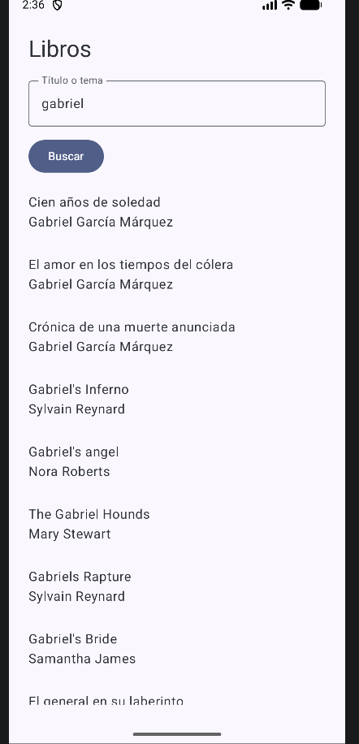
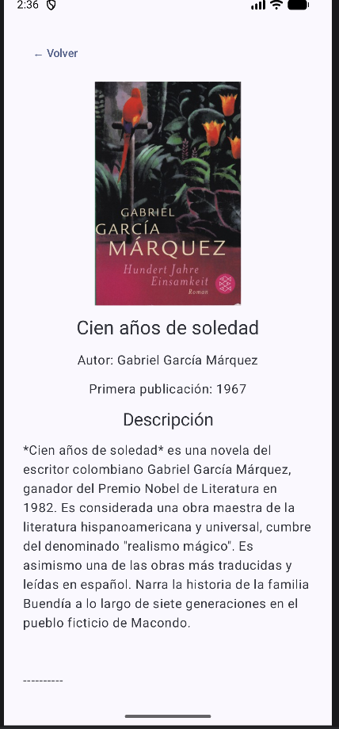

# Buscador de libros

Aplicación Android para buscar libros en [Open Library](https://openlibrary.org/). Escribe un título o tema para consultar resultados y toca un libro para ver su ficha.

## Funciones

- Busca libros por título o tema.
- Muestra el título y el autor de cada resultado.
- Abre una ficha con portada, autor, año de primera publicación y descripción cuando esos datos están disponibles.
- Consulta los datos de Open Library y carga las portadas desde su servicio de imágenes.

## Capturas

### Búsqueda

### Detalle del libro

## Tecnologías

- Kotlin
- Jetpack Compose y Material 3
- Coil 3 para cargar las portadas
- Open Library Search API para buscar libros y API de obras para consultar descripciones

## Ejecutar el proyecto

Abre el proyecto en Android Studio, sincroniza Gradle y ejecútalo en un emulador o dispositivo Android. Se requiere conexión a Internet para buscar libros, portadas y descripciones.
